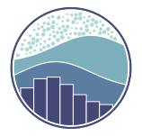
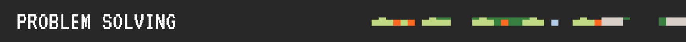
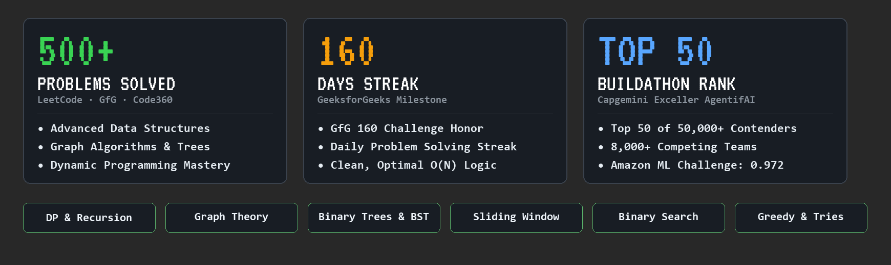

  

  

 

<table border="0" cellspacing="0" cellpadding="0">
  <tr>
    <td width="200" align="center">
      
    </td>
    <td align="center">
      <table border="0" cellspacing="0" cellpadding="8">
        <tr>
          <th>Linkedin</th>
          <th>X (Twitter)</th>
          <th>Gmail</th>
          <th>Website</th>
          <th>LeetCode</th>
          <th>GitHub</th>
        </tr>
        <tr>
          <td align="center">   </td>
          <td align="center">   </td>
          <td align="center">   </td>
          <td align="center">   </td>
          <td align="center">   </td>
          <td align="center">   </td>
        </tr>
      </table>
    </td>
    <td width="200" align="center">
      
    </td>
  </tr>
</table>

  

  <table width="100%">
    <!-- ROW 1: Programming Languages & Core Web -->
    <tr>
      <td align="center" width="10%"> C++</td>
      <td align="center" width="10%"> Python</td>
      <td align="center" width="10%"> JavaScript</td>
      <td align="center" width="10%"> TypeScript</td>
      <td align="center" width="10%"> HTML5</td>
      <td align="center" width="10%"> CSS3</td>
      <td align="center" width="10%"> React</td>
      <td align="center" width="10%"> Next.js</td>
      <td align="center" width="10%"> Tailwind</td>
      <td align="center" width="10%"> Redux</td>
    </tr>
    <!-- ROW 2: Backend, Microservices & Databases -->
    <tr>
      <td align="center" width="10%"> FastAPI</td>
      <td align="center" width="10%"> Django</td>
      <td align="center" width="10%"> Node.js</td>
      <td align="center" width="10%"> Express</td>
      <td align="center" width="10%"> PostgreSQL</td>
      <td align="center" width="10%"> MySQL</td>
      <td align="center" width="10%"> MongoDB</td>
      <td align="center" width="10%"> Redis</td>
      <td align="center" width="10%"> Supabase</td>
      <td align="center" width="10%"> Firebase</td>
    </tr>
    <!-- ROW 3: ML, Data Science & GenAI -->
    <tr>
      <td align="center" width="10%"> Scikit-Learn</td>
      <td align="center" width="10%"> NumPy</td>
      <td align="center" width="10%"> Pandas</td>
      <td align="center" width="10%"> Matplotlib</td>
      <td align="center" width="10%"> Seaborn</td>
      <td align="center" width="10%"> Jupyter</td>
      <td align="center" width="10%"> OpenAI</td>
      <td align="center" width="10%"> DeepSeek</td>
      <td align="center" width="10%"> Ollama</td>
      <td align="center" width="10%"> LangChain</td>
    </tr>
    <!-- ROW 4: Cloud, DevOps & Engineering Tools -->
    <tr>
      <td align="center" width="10%"> Hugging Face</td>
      <td align="center" width="10%"> Docker</td>
      <td align="center" width="10%"> Linux</td>
      <td align="center" width="10%"> Git</td>
      <td align="center" width="10%"> GitHub</td>
      <td align="center" width="10%"> AWS</td>
      <td align="center" width="10%"> Postman</td>
      <td align="center" width="10%"> Cloudinary</td>
      <td align="center" width="10%"> VS Code</td>
      <td align="center" width="10%"> Figma</td>
    </tr>
  </table>

  

  

<picture>
  <source media="(prefers-color-scheme: dark)" srcset="https://raw.githubusercontent.com/Raghavv1206/Raghavv1206/output/github-contribution-grid-snake-dark.svg">
  <source media="(prefers-color-scheme: light)" srcset="https://raw.githubusercontent.com/Raghavv1206/Raghavv1206/output/github-contribution-grid-snake.svg">
  
</picture>

  

<picture>
  <source media="(prefers-color-scheme: light)" srcset="./assets/chess-dark.svg" />
  
</picture>

  <b>♟️ Open Community Chess Tournament</b> 
  Anyone visiting my profile can play! It's your turn to move a <b><!-- BEGIN TURN -->white<!-- END TURN --></b> piece.

<!-- BEGIN CHESS BOARD -->
<!-- END CHESS BOARD -->

  
<b>⚡ Choose Your Move (Click any destination square to play)</b>

 

<!-- BEGIN MOVES LIST -->
|  FROM  | TO (Just click a link!) |
| :----: | :---------------------- |
| **A1** | [A2](https://github.com/Raghavv1206/Raghavv1206/issues/new?body=Please+do+not+change+the+title.+Just+click+%22Submit+new+issue%22.+You+don%27t+need+to+do+anything+else+%3AD&title=Chess%3A+Move+A1+to+A2), [A3](https://github.com/Raghavv1206/Raghavv1206/issues/new?body=Please+do+not+change+the+title.+Just+click+%22Submit+new+issue%22.+You+don%27t+need+to+do+anything+else+%3AD&title=Chess%3A+Move+A1+to+A3) |
| **A4** | [A5](https://github.com/Raghavv1206/Raghavv1206/issues/new?body=Please+do+not+change+the+title.+Just+click+%22Submit+new+issue%22.+You+don%27t+need+to+do+anything+else+%3AD&title=Chess%3A+Move+A4+to+A5), [B5](https://github.com/Raghavv1206/Raghavv1206/issues/new?body=Please+do+not+change+the+title.+Just+click+%22Submit+new+issue%22.+You+don%27t+need+to+do+anything+else+%3AD&title=Chess%3A+Move+A4+to+B5) |
| **B1** | [A3](https://github.com/Raghavv1206/Raghavv1206/issues/new?body=Please+do+not+change+the+title.+Just+click+%22Submit+new+issue%22.+You+don%27t+need+to+do+anything+else+%3AD&title=Chess%3A+Move+B1+to+A3), [C3](https://github.com/Raghavv1206/Raghavv1206/issues/new?body=Please+do+not+change+the+title.+Just+click+%22Submit+new+issue%22.+You+don%27t+need+to+do+anything+else+%3AD&title=Chess%3A+Move+B1+to+C3) |
| **B2** | [B3](https://github.com/Raghavv1206/Raghavv1206/issues/new?body=Please+do+not+change+the+title.+Just+click+%22Submit+new+issue%22.+You+don%27t+need+to+do+anything+else+%3AD&title=Chess%3A+Move+B2+to+B3), [B4](https://github.com/Raghavv1206/Raghavv1206/issues/new?body=Please+do+not+change+the+title.+Just+click+%22Submit+new+issue%22.+You+don%27t+need+to+do+anything+else+%3AD&title=Chess%3A+Move+B2+to+B4) |
| **C2** | [C3](https://github.com/Raghavv1206/Raghavv1206/issues/new?body=Please+do+not+change+the+title.+Just+click+%22Submit+new+issue%22.+You+don%27t+need+to+do+anything+else+%3AD&title=Chess%3A+Move+C2+to+C3), [C4](https://github.com/Raghavv1206/Raghavv1206/issues/new?body=Please+do+not+change+the+title.+Just+click+%22Submit+new+issue%22.+You+don%27t+need+to+do+anything+else+%3AD&title=Chess%3A+Move+C2+to+C4) |
| **D2** | [D3](https://github.com/Raghavv1206/Raghavv1206/issues/new?body=Please+do+not+change+the+title.+Just+click+%22Submit+new+issue%22.+You+don%27t+need+to+do+anything+else+%3AD&title=Chess%3A+Move+D2+to+D3), [D4](https://github.com/Raghavv1206/Raghavv1206/issues/new?body=Please+do+not+change+the+title.+Just+click+%22Submit+new+issue%22.+You+don%27t+need+to+do+anything+else+%3AD&title=Chess%3A+Move+D2+to+D4) |
| **E2** | [E3](https://github.com/Raghavv1206/Raghavv1206/issues/new?body=Please+do+not+change+the+title.+Just+click+%22Submit+new+issue%22.+You+don%27t+need+to+do+anything+else+%3AD&title=Chess%3A+Move+E2+to+E3), [E4](https://github.com/Raghavv1206/Raghavv1206/issues/new?body=Please+do+not+change+the+title.+Just+click+%22Submit+new+issue%22.+You+don%27t+need+to+do+anything+else+%3AD&title=Chess%3A+Move+E2+to+E4) |
| **F2** | [F3](https://github.com/Raghavv1206/Raghavv1206/issues/new?body=Please+do+not+change+the+title.+Just+click+%22Submit+new+issue%22.+You+don%27t+need+to+do+anything+else+%3AD&title=Chess%3A+Move+F2+to+F3), [F4](https://github.com/Raghavv1206/Raghavv1206/issues/new?body=Please+do+not+change+the+title.+Just+click+%22Submit+new+issue%22.+You+don%27t+need+to+do+anything+else+%3AD&title=Chess%3A+Move+F2+to+F4) |
| **G1** | [F3](https://github.com/Raghavv1206/Raghavv1206/issues/new?body=Please+do+not+change+the+title.+Just+click+%22Submit+new+issue%22.+You+don%27t+need+to+do+anything+else+%3AD&title=Chess%3A+Move+G1+to+F3), [H3](https://github.com/Raghavv1206/Raghavv1206/issues/new?body=Please+do+not+change+the+title.+Just+click+%22Submit+new+issue%22.+You+don%27t+need+to+do+anything+else+%3AD&title=Chess%3A+Move+G1+to+H3) |
| **G2** | [G3](https://github.com/Raghavv1206/Raghavv1206/issues/new?body=Please+do+not+change+the+title.+Just+click+%22Submit+new+issue%22.+You+don%27t+need+to+do+anything+else+%3AD&title=Chess%3A+Move+G2+to+G3), [G4](https://github.com/Raghavv1206/Raghavv1206/issues/new?body=Please+do+not+change+the+title.+Just+click+%22Submit+new+issue%22.+You+don%27t+need+to+do+anything+else+%3AD&title=Chess%3A+Move+G2+to+G4) |
| **H2** | [H3](https://github.com/Raghavv1206/Raghavv1206/issues/new?body=Please+do+not+change+the+title.+Just+click+%22Submit+new+issue%22.+You+don%27t+need+to+do+anything+else+%3AD&title=Chess%3A+Move+H2+to+H3), [H4](https://github.com/Raghavv1206/Raghavv1206/issues/new?body=Please+do+not+change+the+title.+Just+click+%22Submit+new+issue%22.+You+don%27t+need+to+do+anything+else+%3AD&title=Chess%3A+Move+H2+to+H4) |
<!-- END MOVES LIST -->

  
<b>📜 Game History & Leaderboard</b>

#### Recent Moves
<!-- BEGIN LAST MOVES -->

| Move | Author |
| :--: | :----- |
| `B7` to `B5` | [ @Raghavv1206](https://github.com/Raghavv1206) |
| `Start game` | [ @Raghavv1206](https://github.com/Raghavv1206) |

<!-- END LAST MOVES -->

#### Top Players
<!-- BEGIN TOP MOVES -->

| Total moves |  User  |
| :---------: | :----- |
| 2 | [@Raghavv1206](https://github.com/Raghavv1206) |

<!-- END TOP MOVES -->

Powered by GitHub Actions & python-chess. When you submit a move issue, automation validates the move, advances the board, and logs your turn.

  

