# ✦ Raghav Mishra ✦
### Frontend & Full-Stack Software Engineer · Bhopal, MP, India

  
  &nbsp;
  
  &nbsp;
  
  &nbsp;
  

<!-- Cinematic Hero Card -->
<picture>
  <source media="(prefers-color-scheme: light)" srcset="./assets/hero-light.svg" />
  
</picture>

<!-- Animated ASCII Terminal Wordmark -->
<picture>
  <source media="(prefers-color-scheme: light)" srcset="./assets/wordmark-light.svg" />
  
</picture>

---

### ✦ The Point of View

> *“I am a passionate 3rd-year B.Tech Computer Science student crafting scalable web applications, fluid user interfaces, and intelligent systems. I believe in small focused teams, ambitious ideas, and shipping software that creates tangible value.”*

- 🔭 **Current Focus**: Architecting full-stack applications with **Next.js 15**, **React 19**, **Python**, and **Generative AI models**.
- 🚀 **Specialty**: High-performance frontend engineering, design systems, and robust API development.
- 💡 **Open for**: Engineering internships, high-impact collaborations, and open-source contributions.

---

### ✦ In the Current Cut

<picture>
  <source media="(prefers-color-scheme: light)" srcset="./assets/highlights-light.svg" />
  
</picture>

The active ideas, experiments, and tech moving the work forward.

---

### ✦ Production Palette

<picture>
  <source media="(prefers-color-scheme: light)" srcset="./assets/stack-light.svg" />
  
</picture>

 

  

Python · JavaScript · TypeScript · React · Next.js · Tailwind CSS · Node.js · Express · Django · MongoDB · PostgreSQL · Docker · Linux

---

### ✦ Featured Reel

<picture>
  <source media="(prefers-color-scheme: light)" srcset="./assets/projects-light.svg" />
  
</picture>

 

#### 🎯 [AdVision](https://github.com/Raghavv1206/Advision) &nbsp;  
> Enterprise-grade, AI-powered advertising platform that revolutionizes multi-platform campaigns. Combines DeepSeek V3.1, Stability AI, Next.js, and Python to generate high-converting ad copy, visual creatives, and real-time performance analytics.  
> **Tech**: `Python` · `Next.js` · `DeepSeek V3.1` · `Stability AI` · `Tailwind CSS`

#### ☕ [Get Me A Chai (v2)](https://github.com/Raghavv1206/get-me-a-chai-version-2) &nbsp; 
> Full-stack creator crowdfunding and patronage platform empowering creators to fund projects one chai at a time. Features seamless creator dashboards, dynamic payment flows, and responsive UI.  
> **Tech**: `JavaScript` · `Next.js 15` · `React` · `Tailwind CSS` · `MongoDB`

#### 💡 [PromptPal](https://github.com/Raghavv1206/PROMPTPAL) &nbsp; 
> AI prompt experimentation and optimization studio. Enables users to refine, benchmark, and analyze prompt outputs across diverse model parameters through an interactive dashboard.  
> **Tech**: `JavaScript` · `React` · `AI Prompt Engine` · `CSS Modules`

#### 🌲 [Bittree](https://github.com/Raghavv1206/Bittree) &nbsp; 
> High-performance link-sharing application inspired by Linktree. Engineered with responsive layouts, customizable themes, and rapid link routing.  
> **Tech**: `JavaScript` · `Next.js` · `Tailwind CSS`

---

### ✦ The City I Built This Year

<picture>
  <source media="(prefers-color-scheme: light)" srcset="./assets/city-light.svg" />
  
</picture>

Every building represents a day; taller structures mark heavier contribution velocity.

---

### ✦ Play The Next Move

<picture>
  <source media="(prefers-color-scheme: light)" srcset="./assets/chess-light.svg" />
  
</picture>

Strategy, patience, and deliberate execution in code and play.

---

### ✦ Keep The Story Moving

I enjoy working with engineers and teams who care about the details, share the context, and ship something useful.

<picture>
  <source media="(prefers-color-scheme: light)" srcset="./assets/social-light.svg" />
  
</picture>

 

  <a href="http://raghavmishra.dev/"><strong>✦ Portfolio: raghavmishra.dev</strong></a> &nbsp;·&nbsp;
  <a href="https://www.linkedin.com/in/raghav-mishra-677418316/"><strong>LinkedIn</strong></a> &nbsp;·&nbsp;
  <a href="https://github.com/raghavv1206"><strong>GitHub</strong></a> &nbsp;·&nbsp;
  <a href="mailto:raghavm205@gmail.com"><strong>Email</strong></a>

Designed & coded by Raghav Mishra

