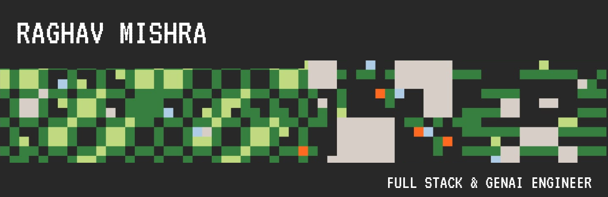
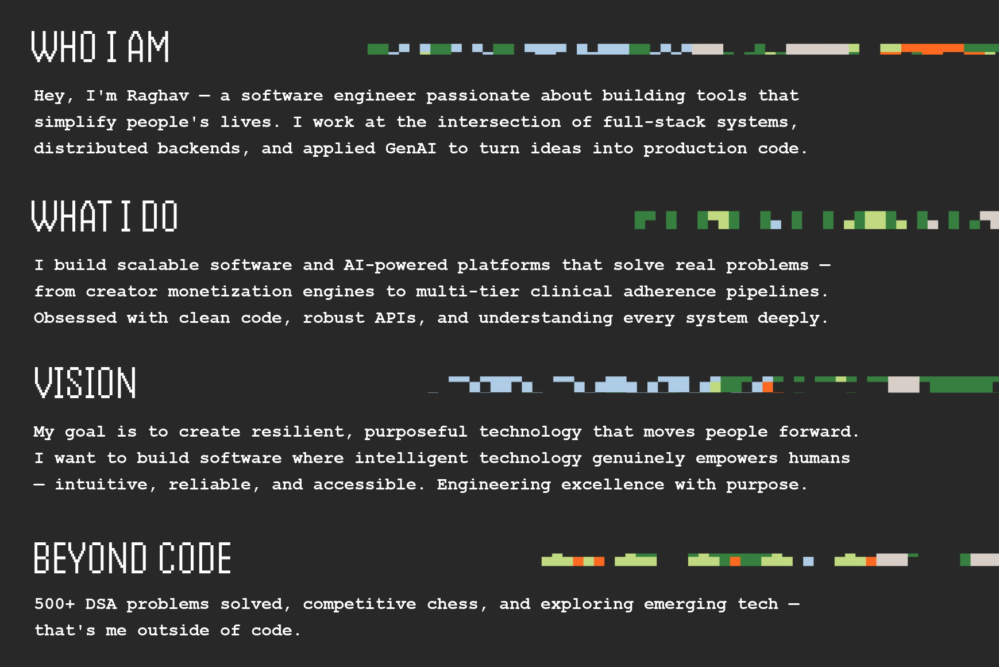
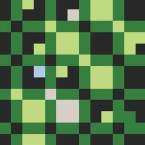
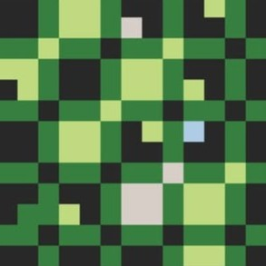
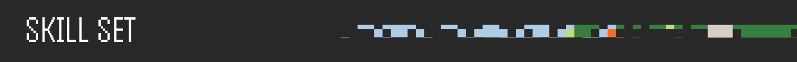
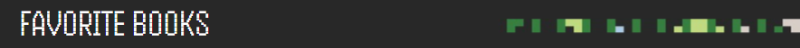
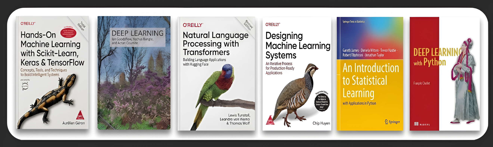
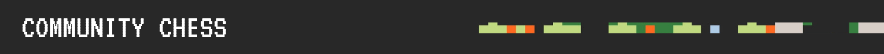

  

  

 

<table border="0" cellspacing="0" cellpadding="0">
  <tr>
    <td width="200" align="center">
      
    </td>
    <td align="center">
      <table border="0" cellspacing="0" cellpadding="8">
        <tr>
          <th>Linkedin</th>
          <th>X (Twitter)</th>
          <th>Gmail</th>
          <th>Website</th>
          <th>LeetCode</th>
          <th>GitHub</th>
        </tr>
        <tr>
          <td align="center">   </td>
          <td align="center">   </td>
          <td align="center">   </td>
          <td align="center">   </td>
          <td align="center">   </td>
          <td align="center">   </td>
        </tr>
      </table>
    </td>
    <td width="200" align="center">
      
    </td>
  </tr>
</table>

  

  <table width="100%">
    <!-- ROW 1: Languages & Core Web -->
    <tr>
      <td align="center" width="10%"> C++</td>
      <td align="center" width="10%"> Python</td>
      <td align="center" width="10%"> JS</td>
      <td align="center" width="10%"> TS</td>
      <td align="center" width="10%"> React</td>
      <td align="center" width="10%"> Next.js</td>
      <td align="center" width="10%"> Tailwind</td>
      <td align="center" width="10%"> Redux</td>
      <td align="center" width="10%"> HTML</td>
      <td align="center" width="10%"> CSS</td>
    </tr>
    <!-- ROW 2: Backend & Databases -->
    <tr>
      <td align="center"> FastAPI</td>
      <td align="center"> Django</td>
      <td align="center"> Node.js</td>
      <td align="center"> Express</td>
      <td align="center"> Postgres</td>
      <td align="center"> MySQL</td>
      <td align="center"> MongoDB</td>
      <td align="center"> Redis</td>
      <td align="center"> Supabase</td>
      <td align="center"> Firebase</td>
    </tr>
    <!-- ROW 3: GenAI, Machine Learning & Data -->
    <tr>
      <td align="center"> PyTorch</td>
      <td align="center"> TensorFlow</td>
      <td align="center"> Sklearn</td>
      <td align="center"> HFace</td>
      <td align="center"> LangChain</td>
      <td align="center"> NumPy</td>
      <td align="center"> Pandas</td>
      <td align="center"> OpenCV</td>
      <td align="center"> OpenAI</td>
      <td align="center"> Streamlit</td>
    </tr>
    <!-- ROW 4: DevOps, Cloud & Tools -->
    <tr>
      <td align="center"> Docker</td>
      <td align="center"> Linux</td>
      <td align="center"> Git</td>
      <td align="center"> GitHub</td>
      <td align="center"> AWS</td>
      <td align="center"> Postman</td>
      <td align="center"> Cloudinary</td>
      <td align="center"> Vercel</td>
      <td align="center"> VS Code</td>
      <td align="center"> Figma</td>
    </tr>
  </table>

  

  

<picture>
  <source media="(prefers-color-scheme: dark)" srcset="https://raw.githubusercontent.com/Raghavv1206/Raghavv1206/output/github-contribution-grid-snake-dark.svg">
  <source media="(prefers-color-scheme: light)" srcset="https://raw.githubusercontent.com/Raghavv1206/Raghavv1206/output/github-contribution-grid-snake.svg">
  
</picture>

  

<picture>
  <source media="(prefers-color-scheme: light)" srcset="./assets/chess-dark.svg" />
  
</picture>

  <b>♟️ Open Community Chess Tournament</b> 
  Anyone visiting my profile can play! It's your turn to move a <b><!-- BEGIN TURN -->black<!-- END TURN --></b> piece.

<!-- BEGIN CHESS BOARD -->
<!-- END CHESS BOARD -->

  
<b>⚡ Choose Your Move (Click any destination square to play)</b>

 

<!-- BEGIN MOVES LIST -->
|  FROM  | TO (Just click a link!) |
| :----: | :---------------------- |
| **A7** | [A5](https://github.com/Raghavv1206/Raghavv1206/issues/new?body=Please+do+not+change+the+title.+Just+click+%22Submit+new+issue%22.+You+don%27t+need+to+do+anything+else+%3AD&title=Chess%3A+Move+A7+to+A5), [A6](https://github.com/Raghavv1206/Raghavv1206/issues/new?body=Please+do+not+change+the+title.+Just+click+%22Submit+new+issue%22.+You+don%27t+need+to+do+anything+else+%3AD&title=Chess%3A+Move+A7+to+A6) |
| **B7** | [B5](https://github.com/Raghavv1206/Raghavv1206/issues/new?body=Please+do+not+change+the+title.+Just+click+%22Submit+new+issue%22.+You+don%27t+need+to+do+anything+else+%3AD&title=Chess%3A+Move+B7+to+B5), [B6](https://github.com/Raghavv1206/Raghavv1206/issues/new?body=Please+do+not+change+the+title.+Just+click+%22Submit+new+issue%22.+You+don%27t+need+to+do+anything+else+%3AD&title=Chess%3A+Move+B7+to+B6) |
| **B8** | [A6](https://github.com/Raghavv1206/Raghavv1206/issues/new?body=Please+do+not+change+the+title.+Just+click+%22Submit+new+issue%22.+You+don%27t+need+to+do+anything+else+%3AD&title=Chess%3A+Move+B8+to+A6), [C6](https://github.com/Raghavv1206/Raghavv1206/issues/new?body=Please+do+not+change+the+title.+Just+click+%22Submit+new+issue%22.+You+don%27t+need+to+do+anything+else+%3AD&title=Chess%3A+Move+B8+to+C6) |
| **C7** | [C5](https://github.com/Raghavv1206/Raghavv1206/issues/new?body=Please+do+not+change+the+title.+Just+click+%22Submit+new+issue%22.+You+don%27t+need+to+do+anything+else+%3AD&title=Chess%3A+Move+C7+to+C5), [C6](https://github.com/Raghavv1206/Raghavv1206/issues/new?body=Please+do+not+change+the+title.+Just+click+%22Submit+new+issue%22.+You+don%27t+need+to+do+anything+else+%3AD&title=Chess%3A+Move+C7+to+C6) |
| **D7** | [D5](https://github.com/Raghavv1206/Raghavv1206/issues/new?body=Please+do+not+change+the+title.+Just+click+%22Submit+new+issue%22.+You+don%27t+need+to+do+anything+else+%3AD&title=Chess%3A+Move+D7+to+D5), [D6](https://github.com/Raghavv1206/Raghavv1206/issues/new?body=Please+do+not+change+the+title.+Just+click+%22Submit+new+issue%22.+You+don%27t+need+to+do+anything+else+%3AD&title=Chess%3A+Move+D7+to+D6) |
| **E7** | [E5](https://github.com/Raghavv1206/Raghavv1206/issues/new?body=Please+do+not+change+the+title.+Just+click+%22Submit+new+issue%22.+You+don%27t+need+to+do+anything+else+%3AD&title=Chess%3A+Move+E7+to+E5), [E6](https://github.com/Raghavv1206/Raghavv1206/issues/new?body=Please+do+not+change+the+title.+Just+click+%22Submit+new+issue%22.+You+don%27t+need+to+do+anything+else+%3AD&title=Chess%3A+Move+E7+to+E6) |
| **F7** | [F5](https://github.com/Raghavv1206/Raghavv1206/issues/new?body=Please+do+not+change+the+title.+Just+click+%22Submit+new+issue%22.+You+don%27t+need+to+do+anything+else+%3AD&title=Chess%3A+Move+F7+to+F5), [F6](https://github.com/Raghavv1206/Raghavv1206/issues/new?body=Please+do+not+change+the+title.+Just+click+%22Submit+new+issue%22.+You+don%27t+need+to+do+anything+else+%3AD&title=Chess%3A+Move+F7+to+F6) |
| **G7** | [G5](https://github.com/Raghavv1206/Raghavv1206/issues/new?body=Please+do+not+change+the+title.+Just+click+%22Submit+new+issue%22.+You+don%27t+need+to+do+anything+else+%3AD&title=Chess%3A+Move+G7+to+G5), [G6](https://github.com/Raghavv1206/Raghavv1206/issues/new?body=Please+do+not+change+the+title.+Just+click+%22Submit+new+issue%22.+You+don%27t+need+to+do+anything+else+%3AD&title=Chess%3A+Move+G7+to+G6) |
| **G8** | [F6](https://github.com/Raghavv1206/Raghavv1206/issues/new?body=Please+do+not+change+the+title.+Just+click+%22Submit+new+issue%22.+You+don%27t+need+to+do+anything+else+%3AD&title=Chess%3A+Move+G8+to+F6), [H6](https://github.com/Raghavv1206/Raghavv1206/issues/new?body=Please+do+not+change+the+title.+Just+click+%22Submit+new+issue%22.+You+don%27t+need+to+do+anything+else+%3AD&title=Chess%3A+Move+G8+to+H6) |
| **H7** | [H5](https://github.com/Raghavv1206/Raghavv1206/issues/new?body=Please+do+not+change+the+title.+Just+click+%22Submit+new+issue%22.+You+don%27t+need+to+do+anything+else+%3AD&title=Chess%3A+Move+H7+to+H5), [H6](https://github.com/Raghavv1206/Raghavv1206/issues/new?body=Please+do+not+change+the+title.+Just+click+%22Submit+new+issue%22.+You+don%27t+need+to+do+anything+else+%3AD&title=Chess%3A+Move+H7+to+H6) |
<!-- END MOVES LIST -->

  
<b>📜 Game History & Leaderboard</b>

#### Recent Moves
<!-- BEGIN LAST MOVES -->

| Move | Author |
| :--: | :----- |
| `A2` to `A4` | [ @Raghavv1206](https://github.com/Raghavv1206) |
| `Start game` | [ @Raghavv1206](https://github.com/Raghavv1206) |

<!-- END LAST MOVES -->

#### Top Players
<!-- BEGIN TOP MOVES -->

| Total moves |  User  |
| :---------: | :----- |
| 1 | [@Raghavv1206](https://github.com/Raghavv1206) |

<!-- END TOP MOVES -->

Powered by GitHub Actions & python-chess. When you submit a move issue, automation validates the move, advances the board, and logs your turn.

  

